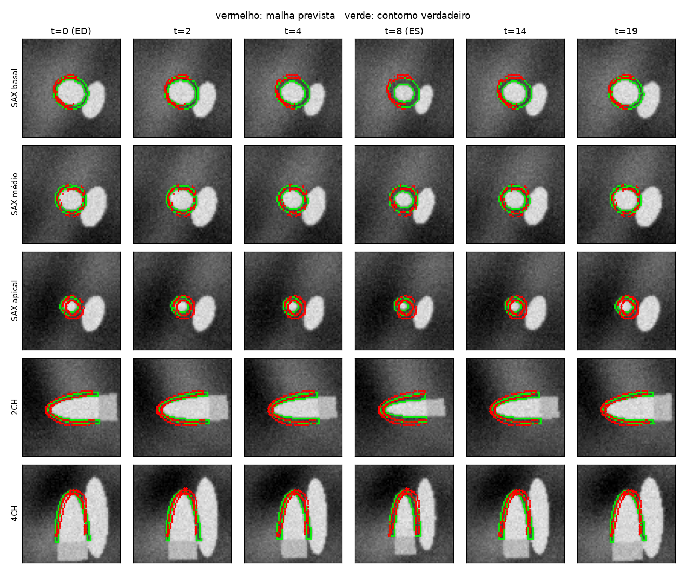
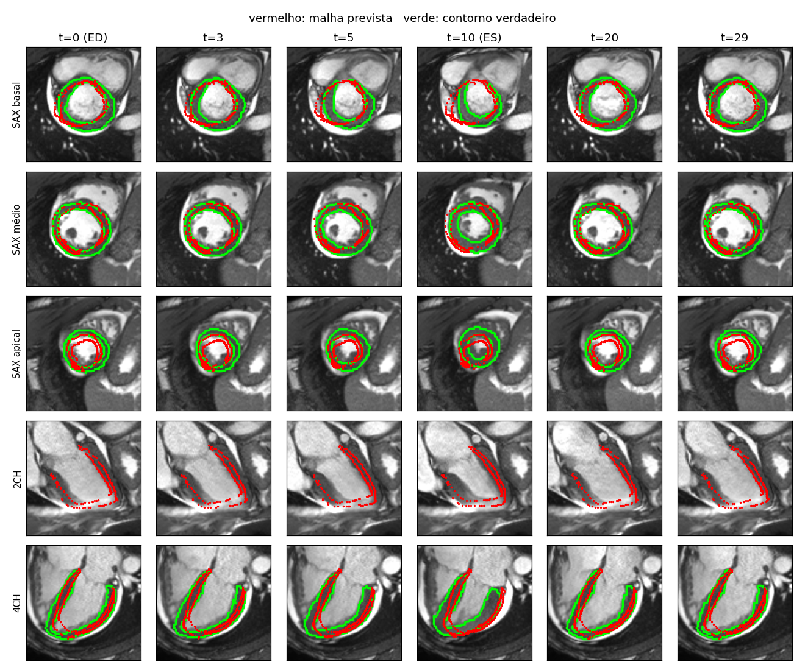

# DeepMesh — reimplementação

Reimplementação em PyTorch de **DeepMesh: Mesh-Based Cardiac Motion Tracking Using Deep Learning**
(Q. Meng, W. Bai, D. P. O'Regan, D. Rueckert — *IEEE Transactions on Medical Imaging*, 43(4):1489–1500, 2024,
doi:[10.1109/TMI.2023.3340118](https://doi.org/10.1109/TMI.2023.3340118)).

O DeepMesh representa o miocárdio do ventrículo esquerdo (VE) como uma malha 3D
(superfícies endo e epicárdica) e estima, a partir de cines 2D de ressonância
(eixo curto SAX + eixos longos 2CH e 4CH), o deslocamento 3D **de cada vértice**
ao longo do ciclo cardíaco. Como todas as malhas vêm do mesmo template, o número de
vértices e a correspondência entre eles se mantêm entre frames e entre sujeitos.

Código original dos autores: <https://github.com/qmeng99/DeepMesh>. Este repositório
é uma implementação própria, feita a partir do artigo e do código de referência, para
estudo. O repositório original não declara licença, por isso nenhum arquivo dele foi
copiado para cá.

## O que está implementado

| Etapa | Conteúdo | Arquivos |
|---|---|---|
| Geometria | afins vóxel↔mundo, *grid sampler* nos vértices, *spatial transformer* | `deepmesh/geometry.py` |
| Template | malha fechada do miocárdio, alinhamento ao sujeito pelos cabeçalhos (Fig. 11) | `deepmesh/mesh.py` |
| Dados | gerador de fantomas sintéticos SAX/2CH/4CH 3D+t, datasets | `deepmesh/synthetic/`, `deepmesh/data.py` |
| Rasterizador | malha → contornos 2D suaves, p = exp(−τd²) (Eq. 9) | `deepmesh/rasterizer.py` |
| Losses | L_shape (Hausdorff ponderado), L_smooth, L_surf, L_reg, L_sim | `deepmesh/losses.py` |
| Redes | H_D (deformação) e H_M (movimento), Fig. 3 | `deepmesh/networks.py` |
| Treino/teste | etapa 1 (reconstrução ED) e etapa 2 (movimento) | `scripts/` |
| Métricas | HD, BoundF, distância de superfície, erro por vértice | `deepmesh/metrics.py` |
| Figuras | contornos ao longo do ciclo, malhas ED/ES, mapas de probabilidade, GIF | `scripts/visualize.py` |
| Dados reais | DICOM (Kaggle) → NIfTI, segmentação com os modelos de Bai et al., preparação + controle de qualidade | `deepmesh/real/`, `scripts/*_real.py`, `notebooks/` |

O mapa equação → função está em [docs/metodo.md](docs/metodo.md).

## Instalação

```bash
conda env create -f environment.yml   # cria o ambiente "deepmesh" (PyTorch CPU)
conda activate deepmesh
python -m pytest                      # 26 testes
```

Para GPU NVIDIA, instale o PyTorch com CUDA (`--index-url https://download.pytorch.org/whl/cu121`).
GPUs AMD funcionam com o PyTorch ROCm (`.../whl/rocm6.1`). Placas integradas como a
Radeon 680M não são suportadas oficialmente, mas costumam funcionar com
`export HSA_OVERRIDE_GFX_VERSION=10.3.0`. O código escolhe a GPU sozinho quando
`torch.cuda.is_available()` (`--device auto`).

## Como rodar (pipeline completo)

```bash
python scripts/generate_synthetic.py        # 400/20/20 sujeitos em data/synthetic (~2,9 GB)
python scripts/train_reconstruction.py      # etapa 1: H_D com L_recon (Eq. 11)
python scripts/test_reconstruction.py       # Tabela I: malha ED reconstruída
python scripts/export_ed_meshes.py          # salva a malha ED prevista de cada sujeito
python scripts/train_motion.py              # etapa 2: H_M com L_motion (Eq. 12)
python scripts/test_motion.py               # Tabela II no frame ES + ciclo inteiro
python scripts/visualize.py --obj           # figuras em outputs/small/figures/
```

Todas as opções vêm de `configs/small.yaml` (CPU) ou `configs/paper.yaml` (valores do
artigo) e podem ser sobrescritas: `--config configs/paper.yaml --set motion.epochs=10 model.views=[sa]`.
O progresso fica em `runs/<config>/<módulo>/history.csv` e no TensorBoard
(`tensorboard --logdir runs`).

### Ablações (Tabelas III e IV)

```bash
# vistas de entrada (e de supervisão): só SAX, SAX+2CH, SAX+4CH
python scripts/train_motion.py --set model.views=[sa] output.models=models/abl_sa output.runs=runs/abl_sa
# combinações de losses: zere os pesos
python scripts/train_motion.py --set motion.beta2=0 motion.gamma2=0 output.models=models/abl_loss output.runs=runs/abl_loss
```

## Dados

Os experimentos do artigo usam 530 sujeitos do **UK Biobank**, de acesso restrito
(é preciso um projeto aprovado), e o template de VE de Bai et al. (2015). Nenhum dos
dois pode ser redistribuído. Por isso este repositório traz um **gerador de fantomas
sintéticos** (`deepmesh/synthetic/phantom.py`) que produz dados com a mesma estrutura:

* VE como duas elipsoides truncadas (endo/epi) com contração radial, encurtamento
  longitudinal (a base desce em direção ao ápice), torção e espessamento da parede;
  VD, átrio, textura de fundo, borramento e ruído;
* pilha SAX reamostrada (H, W, D, T) com planos levemente inclinados, e cines 2CH/4CH
  de fatia única, todos com afins NIfTI que os relacionam no espaço do mundo;
* rótulos do miocárdio em todas as vistas, malhas verdadeiras ED/ES com **outra**
  topologia (como as malhas de *marching cubes* do artigo) e, algo que dados reais não
  têm, a correspondência verdadeira dos vértices em todos os frames.

### Dados reais: Kaggle Data Science Bowl + segmentações de Bai et al.

Não há base pública de acesso imediato com o miocárdio segmentado à mão no SAX, 2CH e 4CH.
A alternativa mais próxima do UK Biobank que dá para usar na hora:

* **Imagens:** [Second Annual Data Science Bowl](https://www.kaggle.com/competitions/second-annual-data-science-bowl)
  (Kaggle), ~1.100 pacientes com cine SAX + 2CH + 4CH em DICOM, com a geometria completa nos
  cabeçalhos. Basta uma conta no Kaggle com telefone verificado e aceitar as regras.
* **Segmentações:** as redes pré-treinadas do [ukbb_cardiac](https://github.com/baiwenjia/ukbb_cardiac)
  (W. Bai, coautor do DeepMesh; Apache-2.0), treinadas **no UK Biobank**. `FCN_sa` segmenta o
  miocárdio no SAX e `FCN_la_4ch_seg4` no 4CH. O modelo de 2CH só segmenta o átrio, então o
  **2CH entra só como imagem** e a L_shape usa SAX + 4CH (`model.shape_views`).

Pipeline (o notebook [notebooks/02_kaggle_dsb_deepmesh.ipynb](notebooks/02_kaggle_dsb_deepmesh.ipynb)
faz tudo no Colab, com GPU, retomando de onde parou se a sessão cair):

```bash
python scripts/dsb_to_nifti.py second-annual-data-science-bowl.zip --out data/native   # DICOM -> NIfTI
python scripts/segment_real.py data/native                                             # precisa de TensorFlow
python scripts/prepare_real.py data/native --config configs/real.yaml                  # formato DeepMesh + QC
python scripts/qc_figure.py data/dsb/train/<sujeito> qc.png --config configs/real.yaml
python scripts/train_reconstruction.py --config configs/real.yaml --resume             # e assim por diante
```

O pré-processamento reamostra o SAX na grade do artigo (128×128×64, com as 10 fatias adquiridas
em k = 7, 12, …, 52), interpola os rótulos entre fatias por distância com sinal, recentra o 2CH e o
4CH no VE, gera as superfícies verdadeiras ED/ES por *marching cubes* e descarta sujeitos que falham
no controle de qualidade (poucas fatias com miocárdio, fração de ejeção implausível, planos LAX
longe do VE, ou 4CH e SAX discordantes, por exemplo por apneias diferentes). O pipeline foi testado
com os 2 sujeitos de demonstração do UK Biobank que acompanham o `ukbb_cardiac`.

[notebooks/01_baixar_cmrxrecon.ipynb](notebooks/01_baixar_cmrxrecon.ipynb) baixa o CMRxRecon 2023
(segmentações manuais) do Synapse para o Google Drive. Esse dataset exige cadastro e aprovação
dos organizadores.

Para usar outros dados reais, basta gravar cada sujeito no mesmo formato
(veja o docstring de `scripts/generate_synthetic.py`): `sa.nii.gz`, `2ch.nii.gz`,
`4ch.nii.gz` (+ `*_myo.nii.gz`) com afins corretas, `template_aligned.npy`
(use `mesh.align_template`), `gt_surface_ed.npz`/`gt_surface_es.npz` e `meta.json`
com os frames ED/ES. O `gt_vertices.npy` é opcional.

## Diferenças em relação ao código original

* **Uma única convenção de eixos.** No original, os vértices eram normalizados como
  (i, j, k) para amostrar o campo, enquanto o *warp* da imagem em L_sim usava (j, i, k).
  Isso só funcionava porque H = W. Aqui o mesmo campo move vértices e imagens com a mesma ordem.
* **Sem `pytorch3d` e sem `neural_renderer`.** O Laplaciano e o Chamfer foram reescritos
  em PyTorch puro (com testes contra força bruta), então o código roda em CPU e em GPUs AMD.
  O `neural_renderer` era importado, mas não era usado.
* **Camada de saída inicializada com zero.** O campo começa nulo: a reconstrução parte do
  template alinhado e o movimento parte da identidade. Com a inicialização aleatória do
  original, os vértices começavam deslocados vários centímetros.
* **Contornos calculados dos rótulos** no carregamento, em vez de arquivos `.npy` pré-computados.
* **Normalização exata para `align_corners=True`** (2i/(H−1) − 1, e não (i − H/2)/(H/2)).
* **Com dados reais**, o eixo do template continua vindo dos planos 2CH/4CH (como na Fig. 11), mas o
  centro vem do VE segmentado: nos dados reais os planos raramente se cruzam no centro do VE.
* As redes são parametrizadas pela largura. Com `width=64`, `width_3d=32` o número de
  parâmetros é **idêntico** ao do original (38.335.043 e 21.764.323; há um teste para isso).

## Limitações

* Nenhum resultado deste repositório é **comparável** aos números do artigo: os sintéticos vêm de
  fantomas em CPU com redes estreitas; os reais vêm do Kaggle com rótulos automáticos, não do
  UK Biobank com rótulos manuais.
* Os métodos de comparação da Tabela II (FFD, dDemons, 3D-UNet, MulViMotion, MeshMotion)
  não estão no repositório original e não foram reimplementados.
* **Dados reais (Kaggle):** os rótulos são automáticos (modelos treinados no UK Biobank, aplicados a
  outros scanners), não manuais; o 2CH não é supervisionado; as superfícies verdadeiras vêm de fatias
  SAX a ~10 mm, sem a super-resolução usada no artigo, e por isso ficam aproximadas na base e no ápice.
* Na config `small`, o pixel tem 2,5 mm. As tolerâncias do BoundF (1 a 5 pixels) ficam,
  portanto, duas vezes mais frouxas em mm que no artigo (1,25 mm).

## Resultados (config `small`, dados sintéticos)

400/20/20 sujeitos (treino/validação/teste), CPU, redes com `width=16`, `width_3d=8`.
HD em mm, BoundF em %, distância de superfície e erro por vértice em mm; média (desvio).

### Etapa 1 — reconstrução da malha ED (Tabela I)

50 épocas (5.000 iterações, ~40 min); checkpoint com a menor loss de validação (época 14).

| Método | HD SAX | HD 2CH | HD 4CH | BoundF SAX | BoundF 2CH | BoundF 4CH | Dist. superfície | Erro por vértice |
|---|---|---|---|---|---|---|---|---|
| Template alinhado (sem rede) | 14,36 (4,95) | 8,25 (2,50) | 8,28 (2,49) | 81,17 (7,12) | 94,65 (3,19) | 94,36 (4,13) | 2,30 (0,50) | 5,07 (1,46) |
| DeepMesh | **13,23** (4,94) | 8,26 (2,60) | 8,91 (2,84) | **82,73** (7,35) | 94,76 (3,16) | 94,39 (3,31) | 2,31 (0,51) | 5,18 (1,56) |

O que aprendemos nesta etapa:

* A rede corrige principalmente a **extensão base–ápice** (HD e BoundF no SAX), mas no teste
  não melhora a distância de superfície. No treino o Chamfer cai de 15,3 para 12,2 mm², enquanto
  na validação fica em ~15: com este orçamento de iterações (~5 mil, contra ~24 mil no artigo) a
  rede **decora** os sujeitos em vez de generalizar.
* Com 100 sujeitos de treino o gap era ainda maior (`runs/small/archive/`). Ir para 400 sujeitos,
  como no artigo, reduziu, mas não eliminou o gap.
* Não é o BatchNorm: recalcular as estatísticas de BN de forma exata ("precise BN") dá o
  mesmo resultado que o modo `eval`.
* Uma causa provável é estrutural: a rede só vê as imagens, não a geometria dos cabeçalhos.
  A posição do template no espaço SAX (que depende dos planos LAX) precisa ser inferida
  indiretamente do conteúdo das imagens.
* Otimizar o campo denso **diretamente** (sem rede) com as mesmas losses leva o Chamfer de 15,5
  a 2,1 mm² em 150 iterações. Isso confirma que as losses e os gradientes estão corretos e que o
  gargalo é a rede aprender o mapeamento imagem → campo.
* Otimizando **só** a L_shape, o mínimo não coincide com a superfície verdadeira (Chamfer 5,6
  contra 0,8 otimizando só o Chamfer): o Hausdorff ponderado tem um piso que depende da
  densidade de vértices no plano. Por isso o artigo combina as losses (Fig. 12).

### Etapa 2 — rastreamento ED → ES (Tabela II)

Partindo da malha ED **reconstruída** pela etapa 1. 100 épocas (10.000 iterações, ~1h50 em CPU).
O baseline "sem movimento" usa a própria malha ED como previsão do ES.

| Método | HD SAX | HD 2CH | HD 4CH | BoundF SAX | BoundF 2CH | BoundF 4CH | Dist. superfície | Erro por vértice |
|---|---|---|---|---|---|---|---|---|
| Sem movimento | 9,80 (2,18) | 14,88 (4,98) | 14,89 (4,53) | 75,02 (5,30) | 89,81 (3,03) | 91,24 (2,74) | 3,22 (0,33) | 7,72 (1,97) |
| DeepMesh, 15 épocas | 9,56 (2,08) | 14,33 (4,54) | 14,29 (4,50) | 76,09 (4,77) | 90,45 (2,91) | 91,69 (2,36) | 3,19 (0,32) | 7,83 (2,08) |
| DeepMesh, 100 épocas | **8,20** (1,92) | **11,48** (3,97) | **11,95** (3,88) | **78,43** (5,32) | **92,54** (2,86) | **92,90** (2,54) | **3,18** (0,36) | 8,18 (2,61) |

<p align="center"></p>

*Malha prevista (vermelho) e contorno verdadeiro (verde) ao longo do ciclo, sujeito de teste 0
(Fig. 7 do artigo). Animação: [docs/figures/cycle.gif](docs/figures/cycle.gif); malhas ED/ES:
[docs/figures/meshes.png](docs/figures/meshes.png); curvas de treino: [docs/figures/curves.png](docs/figures/curves.png).*

O que aprendemos nesta etapa:

* O rastreamento **melhora todos os contornos** em relação a "sem movimento": HD de −16% no SAX
  a −23% no 2CH, e BoundF de +1,7 a +3,4 pontos. O ganho é maior nas vistas LAX, onde aparece o
  encurtamento longitudinal (a base desce cerca de 1 cm na sístole).
* Com 1.500 iterações o ganho era quase nulo, e com 10.000 a validação ainda estava caindo:
  o método precisa de muitas iterações (o artigo usa ~24 mil).
* A distância de superfície e o erro por vértice **não melhoram**. Decompondo o erro no ES:
  o componente **normal** à superfície fica igual (3,48 → 3,54 mm), dominado pelo erro da malha
  ED reconstruída na etapa 1, que o movimento herda. O componente **tangencial** cresce um pouco
  (6,28 → 6,77 mm): deslizamentos ao longo da superfície (como a torção) não aparecem nos
  contornos nem no miocárdio sem textura (problema da abertura). Mesmo otimizando o campo
  diretamente, sem rede, o erro de movimento por vértice só cai de 4,9 para ~4,1 mm. Por isso o
  artigo avalia com contornos e superfície, não por vértice.
* Com intensidades em [0, 1], a L_sim vale ~0,006. Com β2 = 20, ela pesa pouco perto da
  L_shape (~27). Aumentar β2 para 2000 não acelerou o aprendizado (teste de 4 épocas).

### Ablação de vistas (Tabela IV)

Mesmo orçamento para os dois (15 épocas = 1.500 iterações), avaliados no ES:

| Vistas | HD SAX | HD 2CH | HD 4CH | BoundF SAX | BoundF 2CH | BoundF 4CH | Dist. superfície |
|---|---|---|---|---|---|---|---|
| só SAX | **9,16** | 14,93 | 15,34 | **76,19** | 90,04 | 91,19 | 3,21 |
| SAX + 2CH + 4CH | 9,56 | **14,33** | **14,29** | 76,09 | **90,45** | **91,69** | **3,19** |

Mesmo padrão da Tabela IV do artigo: usar só SAX dá o melhor HD no próprio SAX (8,49 no artigo),
enquanto adicionar 2CH e 4CH melhora as vistas longas. Só com SAX, a malha **piora** no 2CH/4CH
em relação a "sem movimento" (14,93/15,34 contra 14,88/14,89 mm), porque o movimento através do
plano SAX não é observado. Com o treino curto, esta comparação é indicativa.

## Resultados com dados reais (Kaggle DSB + segmentações de Bai et al.)

Pipeline de [notebooks/02_kaggle_dsb_deepmesh.ipynb](notebooks/02_kaggle_dsb_deepmesh.ipynb) no Colab,
GPU **L4**, config [configs/real.yaml](configs/real.yaml): grade do artigo (128×128×64, 1,25 mm,
9 fatias SAX em k = 12…52) e redes com a largura do artigo (`width=64`, `width_3d=32`).

* **Dados:** 1.140 estudos → 1.109 convertidos (30 sem alguma vista, 1 com erro) → **726 passaram no
  controle de qualidade**, divididos em 593 / 71 / 62 (treino / validação / teste). O artigo usa 530 sujeitos.
* **Etapa 1:** 200 épocas, batch 4 (~29.600 iterações, ~6h30). **Etapa 2:** 100 épocas, batch 2
  (~29.600 iterações, ~5h20). O artigo faz ~24.000 iterações por etapa.
* O **2CH não tem miocárdio segmentado** (o modelo do Bai para o 2CH só segmenta o átrio): ele entra
  como imagem, mas não é supervisionado nem avaliado (`-` nas tabelas).

HD em mm, BoundF em %, distância de superfície em mm; média (desvio), 62 sujeitos de teste.

### Etapa 1 — reconstrução da malha ED

| Método | HD SAX | HD 4CH | BoundF SAX | BoundF 4CH | Dist. superfície |
|---|---|---|---|---|---|
| Template alinhado (sem rede) | 16,88 (4,69) | 21,08 (6,38) | 37,57 (11,92) | 41,76 (14,43) | 6,94 (1,95) |
| DeepMesh, 100 épocas | 13,16 (4,13) | 16,77 (5,97) | 64,96 (8,30) | 62,17 (13,54) | 3,32 (0,78) |
| DeepMesh, 200 épocas | **10,90** (4,22) | **14,97** (5,47) | **70,94** (8,11) | **69,52** (12,48) | **2,74** (0,72) |

Com dados reais a reconstrução funciona bem: a distância à superfície cai de 6,9 para **2,7 mm**
(cerca de 2 pixels) e o BoundF sobe ~30 pontos. Ao contrário dos dados sintéticos, treino e validação
andam juntos (sem *overfitting*) e a validação ainda melhorava na época 200.

### Etapa 2 — rastreamento ED → ES

Partindo da malha ED reconstruída (200 épocas). "Sem movimento" usa a própria malha ED como ES.

| Método | HD SAX | HD 4CH | BoundF SAX | BoundF 4CH | Dist. superfície |
|---|---|---|---|---|---|
| Sem movimento | 16,35 (7,58) | 19,91 (6,36) | 48,56 (8,75) | 52,69 (11,00) | 4,35 (1,43) |
| DeepMesh | **15,89** (7,90) | **18,50** (7,14) | **51,05** (7,88) | **55,80** (11,26) | **4,20** (1,39) |

<p align="center"></p>

*Sujeito de teste dsb_103. Verde: contorno da segmentação; vermelho: malha prevista. Os contornos
vermelhos quase não mudam ao longo do ciclo, enquanto o verde contrai no ES (t=10). Malhas ED/ES:
[docs/figures/real/meshes.png](docs/figures/real/meshes.png) (a prevista no ES é quase igual à do ED);
curvas de treino: [docs/figures/real/curves.png](docs/figures/real/curves.png) (a `train_shape` do
movimento fica estável em ~44 durante as 100 épocas); animação: [docs/figures/real/cycle.gif](docs/figures/real/cycle.gif).*

O rastreamento melhora todas as métricas, mas **pouco** (HD −3% no SAX e −7% no 4CH; BoundF +2,5 e
+3,1 pontos); nos dados sintéticos o ganho no HD foi de 16–23%. As figuras mostram por quê: **a rede
de movimento quase não deforma a malha**. O maior ganho está no 4CH, onde
aparece a descida da base, como no artigo. Hipóteses para o ganho pequeno, a testar:

1. **Amostragem dos frames:** no treino, t é sorteado no ciclo inteiro, e a maior parte dos frames
   tem pouco movimento; a validação usa sempre o ES, o frame mais difícil. Sortear com mais
   frequência os frames perto do ES deve ajudar: `--set motion.es_prob=0.5` faz metade dos sorteios
   cair a até 2 frames do ES.

Diagnóstico feito com um sujeito real (UK Biobank, demonstração do `ukbb_cardiac`): otimizando o
campo **diretamente**, as losses movem a malha ~6 mm do ED para o ES (L_shape 49,7 → 44,7), e a
**rede**, treinada só nesse sujeito com a taxa do artigo (1e-4), chega ao mesmo nível em 300
iterações (49,7 → 43,7); com 1e-3 fica instável. Ou seja, não há erro nas losses nem na rede: no
treino com 593 sujeitos ela não está conseguindo **generalizar** o movimento. Reduzir λ2 (suavidade)
ajuda pouco e deixa a malha irregular.
2. **Supervisão mais fraca que a do artigo:** rótulos automáticos e sem o 2CH.
3. **Diferença treino × validação** na L_shape (~43 contra ~60): parte vem do frame avaliado (ES),
   parte pode ser *overfitting*. Para separar, avaliar os sujeitos de treino no ES.

### Próximos passos sugeridos

* Testar as hipóteses acima para melhorar o movimento com dados reais (amostragem de frames perto
  do ES, avaliação no conjunto de treino, mais épocas).
* Separar o erro do movimento do erro da reconstrução treinando o movimento com a malha ED
  verdadeira (`--set motion.use_gt_ed_mesh=true`, nos dados sintéticos).
* Validar com segmentações manuais (CMRxRecon, M&Ms-2) quando houver acesso.

## Referência

```bibtex
@article{meng2024deepmesh,
  title   = {DeepMesh: Mesh-Based Cardiac Motion Tracking Using Deep Learning},
  author  = {Meng, Qingjie and Bai, Wenjia and O'Regan, Declan P. and Rueckert, Daniel},
  journal = {IEEE Transactions on Medical Imaging},
  volume  = {43}, number = {4}, pages = {1489--1500}, year = {2024},
  doi     = {10.1109/TMI.2023.3340118}
}
```
